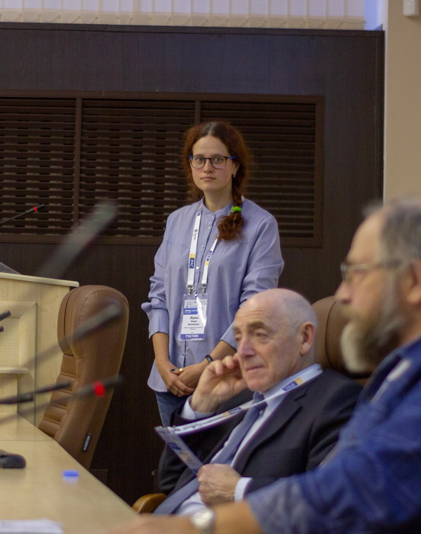



Образование
======
* 2009: Омский государственный педагогический университет, бакалавр физико-математического образования
* 2010: Омский государственный педагогический университет, диплом специалиста с квалификацией «учитель математики»
* 2019: Омский государственный технический университет, преподаватель-исследователь в области математического моделирования, численных методов и программных комплексов (05.13.18)
  * Диссертация: методы и алгоритмы статистической оценки частот сетевых мотивов
  * Присвоенная квалификация: преподаватель-исследователь, научный сотрудник

Опыт работы
======
* Лето 2010 — зима 2011: учитель информатики и математики
  * Школа № 51, Омск
* Зима 2011 — лето 2013: инженер сетей
  * Муниципальное предприятие «Сервис»
* Лето 2013 — осень 2014: преподаватель
  * Колледж коммерции, экономики и сервиса
* Лето 2014 — лето 2016: ассистент
  * Омский государственный технический университет
* Лето 2019 — лето 2024: ассистент
  * Омский государственный технический университет

Навыки
======
* AnyLogic, R (igraph), MathCAD, Gephi, Pajek
* Java, Pascal

Публикации
======
  <ul>
    
    
  </ul>

Доклады
======
  <ul>
    
    
  </ul>

Гранты и награды
======
* Молодёжная премия имени Н. П. Бусленко (от Национального общества имитационного моделирования), 2019

